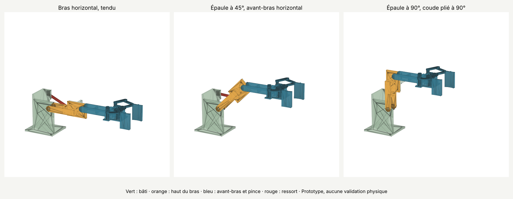

# Épaule du bras (V1, 14/11/2026)

**Prototype : aucune validation physique.** Dessinée et contrôlée par le calcul, jamais imprimée ni montée.

## Le principe : on reprend ce qui marche au coude

- Le servo d'épaule est couché dans un **berceau** identique à celui du coude, vissé sur le mur du **bâti**.
- Le **haut du bras** est une fourche comme l'avant-bras (deux moitiés vissées sur les deux disques du servo),
  prolongée par une **platine** où se visse le berceau du coude. Axe d'épaule → axe du coude : 120 mm.
- Un **ressort de traction** relie une vis du haut du bras à l'un des **12 trous du mât** du bâti. Il porte une
  bonne partie du poids du bras.
- Axe de l'épaule à 95 mm au-dessus du pied. Course prévue : de **−30°** (sous l'horizontale) à **+90°** (vertical).
- L'avant-bras et la pince sont décalés de 54 mm sur le côté du haut du bras : ils passent à côté, jamais dedans.

## Le ressort

**Ressort de traction 70 × 10 × 1,2 mm** (longueur 70 crochets compris, diamètre extérieur 10, fil 1,2).
Le 60 × 10 × 1,2 convient aussi. Pas le 50 × 12 × 1,5 (trop raide).

Pesée du 14/11/2026 : coude + avant-bras + pince sans doigts ni bras libres = 281 g, soit environ **350 g**
pince complète, et 0,98 g/cm³ pour les pièces imprimées à 40 %. Avec le haut du bras : environ 435 g à lever.

| Effort demandé au servo d'épaule (il tient 10 kg·cm en continu, 30 en blocage) | sans ressort | avec le ressort |
|---|---|---|
| Pince vide, au pire | 8,3 kg·cm | **5,6 kg·cm** |
| Gobelet plein de 300 g, au pire | 18,8 kg·cm | **14 kg·cm** |

À savoir :
- Avec un gobelet **plein**, on reste au-dessus de ce que le servo tient en continu : il le lèvera, mais ne doit pas
  le garder en l'air longtemps. Avec 200 g, on est autour de 10. Un ressort seul ne fait pas mieux sur ce bras ;
  les solutions suivantes : un ressort tiré par un cordon (compensation presque parfaite), ou un deuxième servo.
- Le **coude** a la même limite : avant-bras horizontal avec un gobelet plein, il est à 10,5 kg·cm, sans ressort.
- Au-dessus de 65° environ, le ressort est **détendu** : il pend entre ses deux vis. C'est normal.
- Le calcul dépend du ressort reçu (raideur à ± 20 %) : c'est pour ça qu'il y a 12 trous.
  `python calcul_ressort.py --fil 1.2 --diametre 10 --longueur 70` donne le meilleur trou ; si tu as mesuré le
  ressort (une bouteille d'un litre l'allonge de X mm → raideur = 9,81 / X) :
  `python calcul_ressort.py --longueur 70 --raideur 0.66 --force-max 55`.

## À imprimer (PLA ou PETG, 4 périmètres, 40 %, couches de 0,2, sans support, déjà orientées)

| Pièce | Fichier (`sortie/`) | Nombre | Environ |
|---|---|---|---|
| Bâti (pied, mur, mur arrière, mât) | `epaule_bati.stl` | 1 | 250 g, 129 × 110 × 157 mm : la grosse impression |
| Berceau à inserts | `berceau_a_inserts.stl` | **2** (épaule et coude) | 33 g |
| Bride du berceau | `bride_berceau.stl` | 1 de plus (celle du coude resservira) | 2 g |
| Haut du bras, moitié haute (avec la platine) | `epaule_bras_haut.stl` | 1 | 57 g |
| Haut du bras, moitié basse | `epaule_bras_bas.stl` | 1 | 23 g |

**Pourquoi un nouveau berceau pour le coude aussi :** la fourche passe 2 mm au-dessus du socle du berceau. Avec
l'ancien berceau (trous de 4,5 mm), les têtes de vis seraient sur le socle, sous la fourche. Le berceau à inserts
a des trous de 4 mm pour des inserts M3 : les vis viennent par-derrière, rien ne dépasse. Tout le reste du berceau
est identique à celui que tu connais (servo, bride, câble).

**Bâti en PETG (15/11/2026)** : la première impression s'est décollée du plateau (grand pied plat, coins vifs). Les coins du
pied sont maintenant arrondis (rayon 12). À l'impression : filament séché (8 h à 55 °C), plaque lavée au liquide vaisselle,
bordure de 8 mm, plateau 85–90 °C, enceinte fermée, colle en bâton sur toute la zone si besoin.

## Visserie

| Quoi | Nombre | Où |
|---|---|---|
| Inserts M3 à chaud | 17 | 4 dans le socle de chaque berceau (au ras du dessous), 2 en haut des colonnes de chaque berceau, 4 dans la moitié basse du bras, 1 dans la moitié haute (vis du ressort) |
| Vis M3 × 10 | 12 | berceau de l'épaule sur le mur (4, par-derrière), berceau du coude sur la platine (4, par-dessous), brides (2 × 2) |
| Vis M3 × 30 | 4 | les deux entretoises du haut du bras (têtes noyées dans la face) |
| Vis M2,5 des disques du servo | 8 | 4 par disque, comme au coude |
| Vis M3 × 16 + rondelles | 2 | accroches du ressort : une dans l'insert du bras, une dans un trou du mât avec un écrou derrière |
| Écrou M3 | 1 | derrière le mât |
| Ressort 70 × 10 × 1,2 | 1 | |
| Vis à bois ou serre-joint | | pour tenir le pied sur la table : indispensable, le bras tendu fait basculer le bâti |

## Montage, dans l'ordre

**Plan illustré, une page par étape : `sortie/plan_montage_epaule.pdf`** (images `sortie/plan_montage_00.png` à `_10.png`,
refait par `python plan_montage.py`). **Attention (17/11/2026, trouvé au montage)** : le socle du berceau du coude recouvre 2 des 4 têtes de vis M3 × 30 du haut
du bras (celles de l'entretoise B, au milieu de la platine). Il faut donc fermer le haut du bras AVANT de visser ce berceau ;
ses 4 vis M3 × 10 restent accessibles par la face intérieure, de chaque côté de la moitié basse (large de 24 mm, vis à ± 22).
L'ordre ci-dessous (berceau du coude en 3) est faux sur ce point : suivre le plan illustré.

**Ordre (16/11/2026)** : le bloc épaule (berceau + servo + haut du bras + bride) se monte À PLAT SUR LA TABLE, comme le
coude, puis se visse au mur par derrière (4 vis M3 × 10, accessibles même bras monté). Trou du mât conseillé pour le ressort 70 × 10 × 1,2 : rangée du haut, colonne la plus
en arrière (x = −46, z = 50 ; `calcul_ressort.py`).

1. Inserts. Dans le socle des berceaux : **au ras du dessous**, jamais au-dessus du socle.
2. Berceau de l'épaule sur le mur du bâti : 4 vis M3 × 10 par-derrière. Le servo ira vers l'arrière.
3. Berceau du coude sur la platine de la moitié haute : 4 vis M3 × 10 par-dessous. **À faire avant de monter le bras.**
4. Servo d'épaule, fourche, bride : exactement comme au coude (`coude-sts3215/LIRE_AVANT_ESSAI_COUDE_V1_2.md`).
   Les 4 vis M3 × 30 des entretoises entrent par la face extérieure, têtes noyées.
5. Servo du coude et avant-bras dans leur nouveau berceau, comme avant.
6. Servo **non alimenté** : lève et baisse le bras à la main, de −30° à 90°. Rien ne doit toucher.
7. **Le ressort en dernier**, bras tenu vers le haut (à 70°, il se pose sans tirer). Lunettes conseillées : il tire
   jusqu'à 4 kg. Ne lâche pas le bras tant que le servo n'est pas alimenté ou le bras posé.
8. Fixe le pied sur la table avant le premier essai motorisé.

## Essai motorisé : `bras/tester_epaule.bat`

Le servo d'épaule doit porter le **n° 2** (à régler dans FD, comme les autres), ou lance `tester_epaule.bat --id N`.

**Ordre conseillé, du moins risqué au plus chargé :**
1. **Haut du bras seul** : sans ressort, sans avant-bras. On vérifie l'étalonnage, le sens et les butées.
2. **Avec l'avant-bras et la pince, sans ressort** : `tester_epaule.bat --coude N` (N = numéro du servo du coude, qui doit
   être branché et alimenté : il est tenu raide). Tape **m** : le programme mesure l'effort du servo à 6 hauteurs.
3. **Avec le ressort** : refais **m** et compare. Change de trou, recommence, garde le trou qui donne l'effort le plus faible.

Ce que fait le programme, et pourquoi il diffère de ceux du coude et de la pince :
- L'épaule **porte** le bras. Le programme ne coupe jamais la force sans te demander de **tenir le bras**.
- Si une sécurité arrête un mouvement (blocage, effort, chaleur), le servo **retient le bras sur place** avec une force
  réduite à 40 %, au lieu de le lâcher.
- Premier lancement, **sans aucun mouvement du moteur** : tu tiens le haut du bras à l'horizontale (zéro), puis tu le lèves
  à la main (le programme en déduit le sens), et il écrit les butées : 30° sous l'horizontale, 90° au-dessus.
- Commandes : `b h 3 6 v` = −20°, 0°, 30°, 60°, 90° · `+` `-` = 10° plus haut ou plus bas · `m` = mesure · `i` = infos · `q` = quitter.

Essayé ici sur un faux servo (étalonnage, mouvements, blocage, double Ctrl+C) ; **pas encore sur le vrai.**

## Premier essai réel, sans ressort (18/11/2026)

Bras complet (haut du bras, coude tenu raide, avant-bras, pince V3), pied serré sur la table, `tester_epaule.bat --coude 1`.
Étalonnage sans moteur réussi (2048 à l'horizontale, butées 1707–3072), mouvements de −20° à +90° sans incident.

| Hauteur (commande `m`) | Charge | Courant | Température |
|---|---|---|---|
| −20° | +7 % | 20 mA | 26 °C |
| 0° | −10 % | 28 mA | 28 °C |
| +20° | −17 % | 94 mA | 26 °C |
| +40° | −14 % | 61 mA | 27 °C |
| +60° | −10 % | 31 mA | 27 °C |
| +80° | −6 % | 14 mA | 31 °C |

À retenir :
- Effort maxi **17–18 %** (seuil de vigilance du programme : 35 %), servo froid : **l'épaule lève et tient le bras à vide sans ressort**.
- Le servo s'arrête 1 à 2° sous la position demandée (le poids le fait fléchir) : tolérance d'arrivée portée à 70 pas pour l'épaule.
- La « charge » lue suit l'écart entre position demandée et position atteinte (≈ 0,85 % par pas) : elle dépend du sens d'arrivée
  (0° : −18 % en descendant, −10 % en montant). Pour comparer deux réglages, toujours utiliser `m` (même enchaînement).
- Courant de maintien très faible (136 mA au plus) : à l'arrêt, les frottements du réducteur portent une bonne part du poids.
  Le calcul (8,3 kg·cm à tenir) est donc pessimiste pour le maintien ; reste à mesurer la LEVÉE avec une charge dans la pince.

## Servo du coude sorti de son berceau (19/11/2026)

Ce qui retient le servo dans le sens de sa longueur : la bride, qui le plaque au fond, et une **nervure** qui bute contre le
bossage du dessous. Sur le bras, le poids de l'avant-bras tire le servo du coude vers le bout ouvert du berceau (bras
baissé) : la nervure de 1,2 mm a cassé et le servo a glissé. `berceau_a_inserts.stl` a maintenant une nervure de **3,4 mm**
(environ 8 fois plus résistante en flexion), le maximum sans entrer dans la zone balayée par la fourche (vérifié de −109° à +109°).
**À réimprimer : le berceau du coude** ; celui de l'épaule quand l'occasion se présente (même nervure fine).
Au remontage : bossage du servo bien DERRIÈRE la nervure, servo au fond, bride serrée.

## Vérifications

| Programme | Ce qu'il vérifie | Résultat |
|---|---|---|
| `calcul_ressort.py` | effort du servo sur toute la course, avec et sans ressort, pince vide ou gobelet plein ; meilleur trou | voir plus haut |
| `generer_epaule.py` | pièces fermées, d'un seul bloc, posées à plat pour l'impression | bon |
| `verifier_epaule.py` | haut du bras de −30° à 90° : rien ne touche le bâti ni le berceau (2 mm au plus près, comme au coude) ; avant-bras et pince grande ouverte, coude de −90° à +90° : ne touchent que la table ; le ressort passe partout depuis les 12 trous ; tous les trous sont en face ; longueurs de vis | bon |

Ce que les calculs ne disent pas : la tenue du mât et du mur quand le ressort tire, le frottement, et le vrai
ressort. La fourche autour du servo est celle du coude, validée à ± 90° ; la plaque haute fait 7 mm au lieu de 4.

## Berceau à parois hautes (23/11/2026)

Avec le poignet complet, le bras penchait de côté à partir du coude : le servo du coude avait du jeu gauche-droite dans son
berceau (constat de Nicolas). Cause : les parois du berceau ne faisaient que 19 mm et ne tenaient que les 10 premiers millimètres
du boîtier du servo, avec 0,2 mm de jeu de chaque côté → bascule de ± 2°, soit plus d'un centimètre au bout du bras.
**`berceau_a_inserts.stl` a maintenant des parois de 41 mm** (elles tiennent 32 mm de boîtier, jusqu'à 2 mm sous la bride).
Même correction dans le support de flexion du poignet (`poignet/sortie/flexion_support.stl`), qui reprend ce berceau.
Vérifié par le calcul : aucun contact sur toute la course à l'épaule, au coude et à la flexion du poignet.
**Monté par Nicolas le 24/11/2026, au coude puis à l'épaule : le servo entre « nickel », « ça tient mieux ».** Au niveau, l'écart
socle → épaule passe de 1,8° à 1,0° (mesure au téléphone, précise à 1 ou 2° près seulement).
En attendant la réimpression : deux tours de ruban adhésif autour du boîtier du servo, là où il entre dans le berceau.

## Ressort posé (23/11/2026) : ce qu'on a appris

Ressort reçu : **70 × 10 × 1,2 mm, celui du dessin** (confirmé par Nicolas). Accroche retenue : rangée du haut du mât, colonne la
plus éloignée de l'épaule (x = −46, z = 50).
- Dans la zone de travail, il divise presque par deux l'effort de l'épaule (mesures dans `bras/LISEZ-MOI.md`).
- **Erreur du dessin : bras à la verticale, il ne reste que 46 mm entre les deux accroches pour un ressort de 70 mm.** Un ressort de
  traction ne se comprime pas : il sert de cale, l'épaule butait vers 87°. Le texte plus haut (« il pend entre ses deux vis ») est faux.
  Contournement retenu : **repos du bras à 80°** dans tous les programmes (`REPOS` dans `bras/test_epaule.py`).
- Accroché en bas du mât, le ressort se décroche quand il se détend : ne pas utiliser les rangées du bas sans butée sur la tige.
- Pour retrouver la verticale avec ce ressort, il faudrait une accroche vers x = −60, z = 24 (trou à percer au bord arrière du mât) :
  l'aide tombe alors de 8,5 à 4,3 kg·cm bras à l'horizontale, là où elle sert le plus. Non retenu : le repos à 80° est préférable.

## Épaule avec le gros servo STS3095 (26/11/2026)

**Prototype : dessinée et contrôlée par le calcul, jamais imprimée ni montée.** `generer_epaule_3095.py`, aperçu
`sortie/apercu_epaule_3095.png`, contrôles `sortie/verification_epaule_3095.json`.

### Ce qui change
- **Le servo descend par le haut dans un berceau en forme de boîte.** Il est tenu par la forme (fond, mur arrière, deux joues,
  lèvre devant) et par une bride vissée dessus. Aucune petite vis du boîtier n'est utilisée : leur place n'est connue qu'à 1 mm près.
- **La fourche du haut du bras passe de 45 à 61,4 mm** entre les deux disques. Les deux moitiés se vissent sur les disques par
  les vis fournies Ø 2,6 × 9 (8 par disque, 4 mm de plastique sous la tête, têtes noyées dans une cuvette).
- **Nouveau bâti** : même pied, mêmes 4 trous (il se revisse sur le plateau du socle sans rien changer au socle). Le mur est
  reculé au bord du pied, le mât du ressort repoussé derrière la fourche élargie.
- **Ne changent pas** : hauteur de l'axe (95 mm au-dessus du pied), longueur épaule → coude (120 mm), platine et berceau du
  coude, avant-bras, poignet, pince.

### À imprimer (PETG, 4 périmètres, 40 %, couches de 0,2, sans support, déjà orientées)

| Pièce | Fichier (`sortie/`) | Environ |
|---|---|---|
| Berceau du STS3095 | `epaule3095_berceau.stl` | 109 g, 79 × 76 × 53 mm |
| Bride | `epaule3095_bride.stl` | 8 g |
| Haut du bras, moitié basse (côté mur) | `epaule3095_bras_bas.stl` | 48 g |
| Haut du bras, moitié haute (avec la platine du coude) | `epaule3095_bras_haut.stl` | 72 g |
| Bâti | `epaule3095_bati.stl` | 258 g, 129 × 110 × 157 mm : la grosse impression |

**Ordre conseillé : le berceau d'abord** (2 à 3 h). On y essaie le servo avant de lancer le reste : il doit descendre par le
haut sans forcer, se poser à plat au fond, sans jeu sensible (0,2 mm prévu de chaque côté). Si c'est bon : la bride et les deux
moitiés du bras, puis le bâti en dernier (mêmes précautions que le premier : filament sec, bordure de 8 mm, plateau à 85-90 °C).
Les deux moitiés du bras ont une cuvette ronde côté plateau : son plafond s'imprime en pont (anneau de 9 mm), sans support.

### Visserie

| Quoi | Nombre | Où |
|---|---|---|
| Inserts M3 (Ø 4,7 × 3,8) | 11 | 4 dans le socle du berceau (côté mur), 2 sur le dessus des joues (bride), 4 dans la moitié basse du bras (entretoises), 1 dans la moitié haute (vis du ressort, facultatif) |
| Vis M3 × 10 | 6 (+ 4) | berceau sur le mur, par-derrière (4) ; bride (2) ; et les 4 du berceau du coude sur la platine, comme avant |
| Vis M3 × 30 | 4 | entretoises du haut du bras : au fond de puits de 13 mm dans la moitié haute (tournevis fin) ; 5 mm de prise dans la moitié basse |
| Vis Ø 2,6 × 9 fournies avec le servo | 8 à 16 | disques du servo (4 par disque suffisent pour un premier essai) |

### Montage, dans l'ordre (plan illustré à faire quand les pièces seront validées)
1. **Avant tout : le servo seul sur la carte**, pour changer son numéro (neuf, il a sans doute le n° 1 du socle) et régler ses
   butées. Vérifier le 12 V sur l'étiquette. Limiter le couple dans le programme : ce servo est trois fois plus fort.
2. Inserts : 4 dans le socle du berceau (par la face qui touche le mur), 2 sur le dessus des joues, 4 dans la moitié basse.
3. **Moitié basse sur le disque côté LOGO** (vis Ø 2,6 × 9, par la cuvette). À faire AVANT de poser le servo : ces têtes sont
   ensuite contre le mur, on n'y accède plus.
4. Berceau sur le mur du bâti : 4 vis M3 × 10 par-derrière.
5. Le servo descend dans le berceau, **logo côté mur**, bout long vers l'arrière : la moitié basse passe entre le socle et le
   servo. Les prises SVG se retrouvent côté extérieur, dessus et dessous. Poser la bride (2 vis M3 × 10).
6. Moitié haute sur l'autre disque (vis Ø 2,6 × 9), puis les 4 vis M3 × 30 des entretoises.
7. Berceau du coude sur la platine, APRÈS avoir fermé le haut du bras (il recouvre 2 des têtes de vis), comme sur l'ancien bras.

### Ce que le calcul a vérifié
- le servo et ses deux disques descendent dans le berceau par le haut sans rien toucher ; une fois en place, il est retenu
  vers le bas, l'avant, l'arrière et les deux côtés par le berceau, vers le haut par la bride ;
- les deux prises SVG restent libres (échancrure dans le fond pour celle du dessous) ;
- bras de −30° à +90° : au plus près 1,5 mm (disques / fond du berceau), 2 mm (moitié basse / berceau), 7 mm du bâti ;
- avant-bras et pince grande ouverte, coude de −90° à +90° : aucun contact avec le bâti, le berceau ni le haut du bras ;
- longueurs de vis (tableau ci-dessus) ; pièces fermées, d'un seul bloc, posées à plat.

### À faire dans les programmes une fois monté
- **Le plan du bras se décale de 8 mm de côté : `DECALAGE_BRAS` passe de −53,5 à −61,5** (`bras/geometrie.py`), puis refaire
  l'apprentissage de la visée (touche A de `trier`).
- Butées et limite de couple du nouveau servo ; le ressort devient sans doute inutile (le mât reste, au cas où).

### Ce que le calcul ne dit pas
La tenue du berceau quand le servo force (il peut développer 95 kg·cm : limiter le couple), le jeu réel du servo dans sa
boîte, l'alimentation (bloc 12 V de 5 A trop juste : 9,8 A au blocage d'après la fiche). Cotes du servo lues sur photo (± 1 mm) :
seule la place des prises SVG en dépend, l'échancrure a 1 mm de marge de chaque côté.
